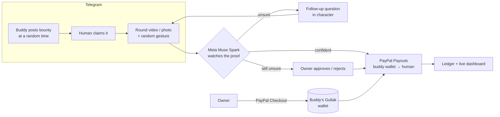

# 🐷 Gullak: your plants and pets pay you to look after them

> *Gullak* (गुल्लक) is the clay piggy bank every kid in India grew up with.
> Here, every plant, pet and object in your home gets its own Gullak: a PayPal-backed wallet and an AI personality.

**Fernanda the Fern** pings your house Telegram group at a random time:

> 🪴 **Fernanda:** HUMANS. My soil is drier than your jokes. **$0.50** to whoever waters me.
> 📸 Proof: a round video message showing the job done **and** you make a ✌️ peace sign.
> **[🙋 I'll do it!]**

You tap the button, water her, and send a 5-second round video. An AI model **watches the video**, checks it's really Fernanda, that water actually went in, and that you made the gesture. Then **Fernanda pays you through PayPal.** If the AI isn't sure, Fernanda asks a follow-up ("I didn't see water go IN the pot"). If it's still unsure, her owner decides with one tap.

Chores get done, nobody nags anyone, and the plant does the paying.

---

## Try it in 60 seconds (judges)

1. Open **[@PaypalAIGullakbot](https://t.me/PaypalAIGullakbot)** in Telegram and press **Start**.
2. Link a PayPal **sandbox personal** account to receive rewards:
   `/link sb-xxxxx@personal.example.com`
   (Any sandbox personal account from developer.paypal.com → Testing Tools → Sandbox Accounts.)
3. Send `/demo`. **Hydro the Water Bottle** 💧 appears with $5 of demo money and posts a bounty.
4. Tap **🙋 I'll do it!**, then record a **round video message** of yourself drinking water while doing the hand gesture Hydro asks for.
5. Watch the AI verdict and the **PayPal payout** arrive. Log in to sandbox.paypal.com with the personal account to see the $0.25.

Also try: reply to any of Hydro's messages to chat with it, send a fake or old photo to see it rejected, or `/topup Hydro 5` to fund it through PayPal Checkout.

---

## How it works



### Money in: owners fund their buddies (PayPal Orders v2)
`/topup Fernanda 10` creates a **PayPal Checkout order**. The owner approves it in PayPal, Gullak **captures** it, and Fernanda's wallet goes up. Capture is triggered three ways and is idempotent: the "I've paid" button, the return URL, and the `CHECKOUT.ORDER.APPROVED` **webhook** (signature-verified when `PAYPAL_WEBHOOK_ID` is set).

### Money out: buddies pay humans (PayPal Payouts v1)
When a proof is verified, Gullak reserves the reward from the buddy's wallet and sends a **PayPal Payout** to the helper's linked PayPal email. It then polls the payout batch (and listens to `PAYMENT.PAYOUTS-ITEM.*` webhooks) and posts PayPal's final status (`SUCCESS`, `UNCLAIMED`, …) back into the chat. Failed payouts are refunded to the buddy's wallet with a one-tap retry.

The House Bank is the PayPal sandbox **business** account. Each buddy's wallet is a sub-ledger backed by it, so one set of API credentials powers any number of buddies.

### AI: the referee, the personality, and the designer (Meta Muse Spark)
| What | How |
|---|---|
| **Video proof checking** | Telegram round videos are uploaded to Meta's Files API and passed to `muse-spark-1.3` together with the buddy's **reference photos**. The model returns structured JSON: `identityMatch`, `taskDone`, `challengeDone`, `looksLive`, `confidence`, what it observed, and what's missing. |
| **Decides the money** | ≥ 75% confidence pays automatically, 40–75% gets a targeted follow-up, and repeated doubt goes to the owner. Missing the gesture or the wrong buddy can never auto-pay. |
| **Buddy designer** | `/newbuddy` + one photo + a caption ("Mochi, sassy cat, feed at 8 and 7, $1") → the model designs the character, chore, proof rules, reward, a **safe cooldown** (no overfeeding or overwatering) and a visual description used to recognise it later. |
| **Personality** | Bounties, verdicts, follow-ups and chat replies are written in character. Reply to a buddy's message to talk to it. |

### Anti-cheat
- **Random liveness gesture** per bounty (✌️ 👍 👌 ✋ ✊ 👉 3 fingers): you can't pre-record proof.
- **Round video messages** can only be recorded live in Telegram, so they get full trust; photos and gallery videos are accepted but trusted slightly less.
- **Identity check** against the owner's reference photos: it has to be *this* plant, not any plant.
- **Duplicate detection** by Telegram file ID and SHA-256 of the bytes: re-sending an old proof is rejected.
- **Claim locks** (15 min) so two people can't race the same bounty, and **owner review** as the final word.

### Welfare and safety rules
Buddies only ask when they actually need something: each has a cooldown (e.g. a fern waters at most every 48–96h, a cat eats at most every 8–12h) and awake hours. If a bounty is ignored too long, the buddy raises the reward 50% (surge pricing 😤) instead of asking more often.

---

## Run it yourself

**Requirements:** Node.js 20+, a Telegram bot token (@BotFather), a PayPal sandbox app (developer.paypal.com) with **Payouts** enabled, and a Meta Model API key (dev.meta.ai).

```bash
git clone https://github.com/50ur48h/Gullak.git
cd Gullak
npm install
cp .env.example .env      # Windows: copy .env.example .env
# fill in TELEGRAM_BOT_TOKEN, PAYPAL_CLIENT_ID, PAYPAL_CLIENT_SECRET, META_API_KEY
npm run check             # verifies all three connections
npm start
```

In @BotFather, set **Bot Settings → Group Privacy → Turn off** so the bot can see proof videos in group chats. Then add the bot to your house group and send `/newbuddy`.

Open **http://localhost:3000** for the live house-economy dashboard (buddy wallets + PayPal ledger with the AI's evidence for every payout).

`DEMO_MODE=true` (default) makes buddies ask for help within minutes instead of hours. Set it to `false` for real life.

### Deploy on Render
The repo includes `render.yaml`. Create a new **Blueprint** from this repo on Render and paste the four secrets. Set `PUBLIC_URL` to your Render URL so PayPal redirects back to a "payment approved" page, and add `https://<your-app>.onrender.com/paypal/webhook` as a webhook in your PayPal app (events: *Checkout order approved*, *Payouts item* events).

---

## Commands

| Command | What it does |
|---|---|
| `/demo` | Create Hydro the Water Bottle with $5 demo credit and post a bounty |
| `/link email` | Link the PayPal account that receives your rewards |
| `/newbuddy` | Photo + description → AI-designed buddy |
| `/addphoto name` | Add reference photos (better fake detection) |
| `/topup name amount` | Fund a buddy's wallet with PayPal Checkout |
| `/bounty name` | Owner: post a bounty now |
| `/buddies`, `/wallet` | Buddies, balances, moods |
| `/leaderboard`, `/history`, `/me` | Who earned what |
| `/pause name`, `/resume name` | Holiday mode |
| `/status` | Check PayPal + AI connectivity |

---

## Tools used

| Tool | Used for |
|---|---|
| **PayPal Orders v2 API** | Owner top-ups (create, approve, capture) |
| **PayPal Payouts API** | Rewards from buddy wallets to helpers, plus status tracking |
| **PayPal Webhooks** | Order-approved and payout-item events, with signature verification |
| **PayPal Sandbox** | Business account as House Bank, personal accounts as helpers |
| **Meta Model API: Muse Spark 1.3** | Video and image understanding for proof checking, structured JSON verdicts, buddy design from a photo, in-character dialogue |
| **Telegram Bot API (grammY)** | Group chat UX, live round-video proofs, inline buttons |
| **Express** | Dashboard, PayPal return pages, webhook endpoint |
| **Render** | Hosting |

## Project structure
```
src/
  index.js      startup
  bot.js        Telegram commands, buttons, media handlers
  game.js       bounties, claims, proof checking, payouts, top-ups
  ai.js         Meta Muse Spark calls (verify proof, design buddy, personality)
  paypal.js     PayPal OAuth, Payouts, Orders, webhook verification
  scheduler.js  random bounty timing, claim expiry, surge pricing
  server.js     dashboard + PayPal return/webhook routes
  db.js         tiny JSON-file database
scripts/check.js  connection checker
```

## License
MIT. See [LICENSE](LICENSE).
