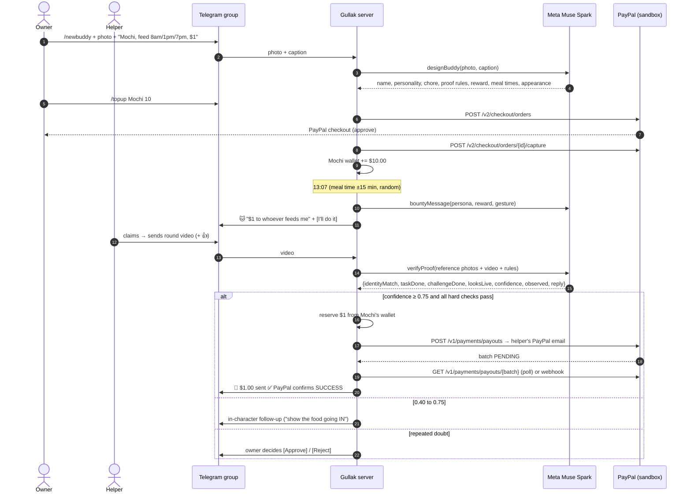
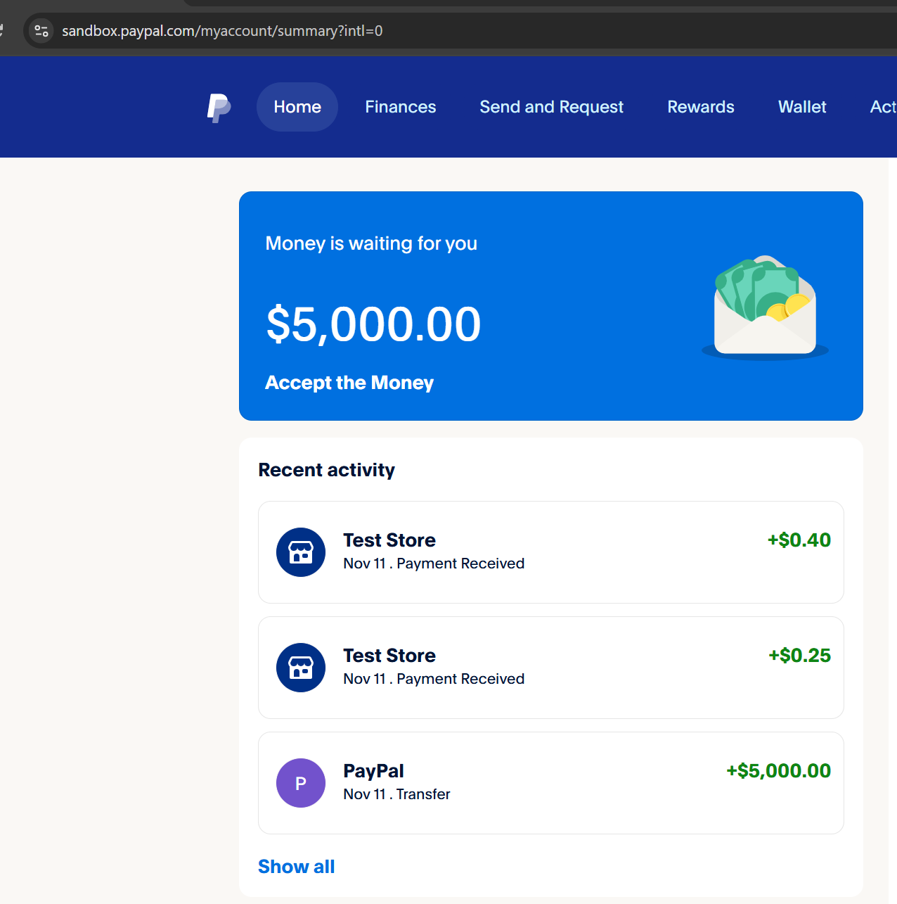

# 🐷 Gullak: your plants and pets pay you to look after them

      

> *Gullak* (गुल्लक) is the clay piggy bank every kid in India grew up with.
> Gullak gives every plant, pet and object in your home its own piggy bank (a PayPal-backed wallet) and an AI personality. It then **pays the humans who look after it**, but only after AI has **watched video proof** that the job was really done.

| | |
|---|---|
| 🤖 **Try the bot** | **[t.me/PaypalAIGullakbot](https://t.me/PaypalAIGullakbot)** → send `/demo` (60-second walkthrough [below](#-try-it-in-60-seconds)) |
| 📊 **Live dashboard** | **[gullak-production.up.railway.app](https://gullak-production.up.railway.app/)** (wallets + PayPal ledger with the AI's evidence for every payout) |
| 🎬 **Demo video** | **[youtube.com/watch?v=6DsYvHDKtZc](https://www.youtube.com/watch?v=6DsYvHDKtZc)** (under 3 min: a real cat, real PayPal sandbox payouts) |
| 📦 **Run it yourself** | [Setup instructions](#-run-it-yourself) (Node 20, 4 env vars, `npm start`) |

---

## The idea in 20 seconds

In a house group chat, **Mochi the cat** posts at 1:07pm:

> 🐱 **Mochi:** Servants. The bowl is EMPTY and I am wasting away. **$1.00** to whoever feeds me.
> 📸 Proof: a round video message showing the job done **and** you give a 👍 thumbs up.
> **[🙋 I'll do it!]**

Charli taps the button, feeds Mochi, and records a 5-second round video. **Meta's Muse Spark model watches the clip**: it checks it's *this* cat (compared against reference photos), that food actually went into the bowl, and that the thumbs-up appears. Seconds later **Mochi pays Charli $1.00 through PayPal Payouts**, and PayPal confirms `SUCCESS` in the chat.

If the AI isn't sure, Mochi asks a pointed follow-up in character ("I saw a bowl. I did not see FOOD go in it."). If it's still unsure after three tries, Mochi's owner decides with one tap.

**Nobody nags anyone. The pet does the paying.**

## Why it needs both PayPal *and* AI

Neither half works alone:

- **Without AI**, paying people for chores means a human has to check every photo, or the system trusts everyone and gets gamed. Muse Spark **watches the video, compares it to reference photos, checks a random liveness gesture, and outputs a structured verdict**. That verdict is what decides whether PayPal moves money.
- **Without PayPal**, the buddy's promise of "$1 to whoever feeds me" is just a game. With PayPal, owners fund wallets through **real Checkout (Orders v2)**, and verified helpers receive **real Payouts**, with status confirmed back into the chat.

**AI is the judge, PayPal is the bank, and the household gets a chore system that runs itself.**

---

## 👥 Who it's for

| Who | The everyday problem | What Gullak changes |
|---|---|---|
| **Couples and roommates** | "Did anyone feed the cat?" Shared pets and plants get forgotten or double-fed, and chores turn into arguments. | The cat asks for food at mealtime, one person claims it, and the video proves it. Exactly one feeding per meal, and a leaderboard shows who's doing their share. |
| **Families with kids and teens** | Pocket money feels like free money, and "do your chores" is a daily fight. | Kids earn small amounts for real responsibilities (feed the dog, water the garden) from the buddy itself. That's the original idea of a *gullak*: small coins, earned and saved, become something big. **Today** a parent's PayPal receives the payouts on the child's behalf, because PayPal accounts are 18+. **Next:** PayPal Payouts can already send to **Venmo**, and Venmo offers parent-managed **Teen Accounts (ages 13–17)**, a natural path to paying teens directly. |
| **Pet owners who travel** | Paying a neighbour to feed the cat means trusting they actually came, twice a day. | Every visit is a verified video, and payment happens per visit, automatically, through PayPal. Peace of mind for owners, instant pay for sitters. |
| **People who care about each other's habits** | "Drink some water" turns into nagging. | A partner funds a buddy that pays *you* to drink water, stretch or walk the dog. Care becomes encouragement, not reminders. |
| **Neighbours, offices and community gardens** | Shared plants die because they're everyone's job and nobody's. | Anyone nearby can claim a bounty. The owner funds it, the plant pays whoever turns up. |

---

## ✅ Hackathon requirements: where each is met

| Requirement | How Gullak meets it | Where to look |
|---|---|---|
| **Meaningful PayPal integration** | 3 PayPal products in the core loop: **Payouts** (rewards out), **Orders v2** (wallet top-ups in: create → approve → capture), **Webhooks** (signature-verified). Money is reserved before paying, refunded on failure, and every payout's final status is confirmed with PayPal. | [`src/paypal.js`](src/paypal.js), [`src/game.js`](src/game.js) (`payBounty`, `confirmPayout`, `startTopup`, `completeTopup`), [`src/server.js`](src/server.js) |
| **Meaningful AI** | AI **decides whether money moves**: video and photo proof verification with structured JSON verdicts. It also designs each buddy from one photo, sets welfare-safe schedules, and writes all dialogue in character. | [`src/ai.js`](src/ai.js) (`verifyProof`, `designBuddy`, `bountyMessage`, `buddyChat`) |
| **Working prototype** | Live Telegram bot + hosted dashboard. Real sandbox payouts received (screenshot below). | [Try it](#-try-it-in-60-seconds), [Evidence](#-evidence-it-works) |
| **Documentation** | This README, setup steps, architecture, commands, decision policy. | You're reading it |
| **Tools disclosed** | Meta Model API (`muse-spark-1.3`), Google Gemini API (backup), PayPal REST APIs, Telegram Bot API, Railway. | [Tools used](#-tools-used-and-how) |
| **Open source** | MIT license, full source, `.env.example`, no secrets committed. | [`LICENSE`](LICENSE) |

---

## 🔁 How it works



---

## 💳 PayPal integration in depth

| PayPal API | Used for | Code |
|---|---|---|
| `POST /v1/oauth2/token` | Client-credentials auth, token cached until expiry | `accessToken()` in [`paypal.js`](src/paypal.js) |
| **`POST /v1/payments/payouts`** | **Buddy → helper reward** after AI verification, with an idempotent `PayPal-Request-Id` and a personal note ("🐱 Mochi says thanks for: feed me") | `sendPayout()` |
| `GET /v1/payments/payouts/{batch_id}` | Poll until the item reaches a final status (`SUCCESS`, `UNCLAIMED`, `FAILED`, …), then post it to the chat. Also re-checked on startup if the server stopped mid-payout. | `getPayout()`, `confirmPayout()`, `resumePendingPayouts()` |
| **`POST /v2/checkout/orders`** | **Owner → buddy wallet top-up** (`intent: CAPTURE`, `NO_SHIPPING`, `PAY_NOW`, Gullak branding, return/cancel URLs) | `createTopupOrder()` |
| `GET /v2/checkout/orders/{id}` + `POST …/capture` | Confirm approval, then capture, idempotently. The same order can be completed by the "I've paid" button, the return URL, or a webhook without double-crediting. | `getOrder()`, `captureOrder()`, `completeTopup()` |
| `POST /v1/notifications/verify-webhook-signature` | Verifies `CHECKOUT.ORDER.APPROVED` and `PAYMENT.PAYOUTS-ITEM.*` webhooks really came from PayPal (when `PAYPAL_WEBHOOK_ID` is set) | `verifyWebhook()`, `/paypal/webhook` in [`server.js`](src/server.js) |

**Money model.** The sandbox **business** account acts as the House Bank. Each buddy's wallet is a sub-ledger backed by it, so one set of API credentials serves any number of buddies and households. Helpers receive Payouts in their own PayPal accounts.

**Money safety rules**

1. **Reserve, then pay.** The reward is deducted from the buddy's wallet *before* the Payout call, so two simultaneous approvals can't spend the same money.
2. **Refund on failure.** If PayPal rejects the payout, the money returns to the wallet and a 🔁 Retry button appears.
3. **No payout without funds.** A broke buddy doesn't post bounties. It asks its owner for a top-up instead, with one-tap PayPal buttons.
4. **Idempotent capture.** A top-up order can only be credited once, whichever of the three confirmation paths arrives first.
5. **Full ledger.** Every reward stores the PayPal batch ID, final PayPal status, transaction ID, **the AI's observation and confidence**. It appears on `/history` and the live dashboard.

---

## 🧠 AI in depth (Meta Model API, `muse-spark-1.3`, with Google Gemini as backup)

Gullak calls Meta's OpenAI-compatible **Responses API** with **JSON-schema structured output** (with a fallback to plain JSON prompting if the schema is refused).

**Backup provider: Google Gemini.** On startup Gullak asks Meta which models its key can use from that server. If Muse Spark isn't available there, or a Meta call fails, the same requests (photos, inline round videos, JSON verdicts) go to **Google Gemini** instead ([`src/gemini.js`](src/gemini.js), native REST API, no extra dependencies). It defaults to `gemini-3.5-flash` for speed and reliability, and walks through newer Flash models if one is busy, retired or over quota, re-trying the preferred one every 10 minutes. Quick tasks (bounty posts, chat) use low thinking; proof checks keep full reasoning. The decision policy below is identical whichever model answers. `AI_PROVIDER=auto|meta|gemini` forces a choice; the default `auto` means Meta first, Gemini as backup.

> The hosted bot on Railway currently runs on **Gemini**: Meta's API returns no models for our key from Railway's servers, while the same key works from our local machine.

| AI role | Input | Output | Why it matters |
|---|---|---|---|
| **1. Proof referee** (`verifyProof`) | Up to 3 **reference photos** of the buddy + the helper's **round video** (sent inline as mp4, or via the Files API for large files) or photo + chore rules + the random gesture | `identityMatch`, `taskDone`, `challengeDone`, `looksLive`, `confidence`, `observed`, `missing`, in-character `reply` | **This verdict decides whether PayPal sends money.** |
| **2. Buddy designer** (`designBuddy`) | One photo + a free-text caption | Name, emoji, personality, chore, proof rules, reward, **welfare-safe cooldown**, **meal times**, a precise appearance description | Setup takes one photo instead of a form. The appearance text helps catch "wrong cat" fakes. |
| **3. Voice** (`bountyMessage`) | Persona, reward, time since last care, gesture, meal time | The bounty post | Turns a chore into something people want to respond to |
| **4. Chat** (`buddyChat`) | Reply to any buddy message | In-character answer that knows its wallet balance | Makes the buddy feel alive, and lets it beg for a top-up |

### Decision policy: AI confidence plus hard rules

AI output alone never moves money. It goes through a deterministic policy ([`game.js` → `handleProof`](src/game.js), thresholds in [`config.js`](src/config.js)):

| Condition | Result |
|---|---|
| Wrong buddy, chore not done, gesture missing, or not a live capture | Confidence is **capped at 0.60**, so it can **never auto-pay** |
| Confidence **≥ 0.75** | **PayPal Payout sent automatically** |
| 0.40 to 0.75 | In-character **follow-up** asking for the specific missing thing |
| Still not convinced after **3 attempts** | **Owner review** with ✅ / ❌ buttons (only the owner can press them) |
| Photo instead of a live round video | Confidence capped slightly lower, since live video is stronger evidence |

**Speed tuning.** Muse Spark is a reasoning model. Proof checks use full reasoning (about 9–12 seconds). Bounty posts and chat use lower reasoning effort (about 5 seconds). Output budgets are sized so reasoning never cuts off the JSON answer.

---

## 🛡 Anti-cheat

| Attack | Defence |
|---|---|
| Re-using an old photo or video | Duplicate detection by Telegram `file_unique_id` **and** SHA-256 of the bytes |
| Pre-recording a fake | **Random gesture per bounty** (✌️ 👍 👌 ✋ ✊ 👉, three fingers). Proof must include it. |
| Uploading a video from the gallery | **Round video messages** can only be recorded live in Telegram, so they get full trust. Photos and gallery videos are trusted less. |
| Showing a different plant or cat | **Identity check** against the owner's reference photos and the AI-written appearance description |
| Two people racing for one bounty | **15-minute claim lock**. Unclaimed or ghosted bounties reopen automatically. |
| AI gets it wrong | **Owner review** is the final word, and owner rejection rotates to a new gesture |

## 🐾 Welfare and safety by design

A bounty system must never reward overfeeding or overwatering:

- **Fixed meal times for pets.** "Feed her at 8am, 1pm and 7pm" becomes meal slots in the household's timezone. **One bounty per meal**, posted at a random moment within ±15 minutes. **Never twice for the same meal**, even across restarts. If a meal is missed, it's skipped rather than posted late. `/feednow` (owner) serves the next meal early.
- **AI-chosen safe cooldowns** for other buddies (for example, ferns at most every 48–96 hours) plus "awake hours".
- **Surge pricing, not spam.** If nobody responds, the buddy raises its reward by 50% once instead of asking more often.
- **Owner controls:** `/pause` and `/resume` (holiday mode), owner-only bounties and reviews.

---

## 📸 Evidence it works

Real sandbox Payouts received by a helper's PayPal account after AI-verified proofs: **+$0.25** (Hydro's first bounty) and **+$0.40** (after Hydro raised its reward):



Everything else is reproducible: run `/demo` with the live bot, or `npm run check` locally, which tests the Telegram, PayPal and AI connections in one go.

---

## 🚀 Try it in 60 seconds

1. Open **[@PaypalAIGullakbot](https://t.me/PaypalAIGullakbot)** and press **Start**.
2. Link a **PayPal sandbox personal** account (developer.paypal.com → Testing Tools → Sandbox Accounts) to receive rewards:
   `/link sb-xxxxx@personal.example.com`
3. Send **`/demo`**. **Hydro the Water Bottle** 💧 appears with $5 of demo credit and posts a bounty.
4. Tap **🙋 I'll do it!** Hold Telegram's camera button to record a **round video** of yourself **drinking water** and doing **the gesture Hydro asked for**.
5. Watch the AI's checklist (✅ identity, ✅ job done, ✅ gesture), then **💸 $0.25 sent via PayPal**, then **✅ PayPal confirms SUCCESS**.
6. Log in to sandbox.paypal.com as that personal account to see the money.

Also try sending an unrelated photo (rejected in character), re-sending the same video (duplicate detected), replying to Hydro to chat, or `/topup Hydro 5` to fund it through PayPal Checkout.

## 💬 Commands

| Command | What it does |
|---|---|
| `/demo` | Create Hydro the Water Bottle with $5 demo credit and post a bounty |
| `/link email` | Link the PayPal account that receives your rewards |
| `/newbuddy` | Photo + description → AI-designed buddy (personality, chore, reward, safe schedule) |
| `/addphoto name` | Add reference photos for stronger identity checks |
| `/topup name amount` | Fund a buddy's wallet through PayPal Checkout |
| `/bounty name` | Owner: post a bounty now |
| `/feednow name` | Owner: serve the next fixed meal early (that meal won't repeat) |
| `/buddies`, `/wallet` | Buddies, balances, moods, schedules |
| `/leaderboard`, `/history`, `/me` | Who earned what, recent PayPal transactions |
| `/pause name`, `/resume name` | Holiday mode |
| `/status` | Live check of the PayPal and AI connections (shows which model is answering) |

---

## 🛠 Run it yourself

**You need:** Node.js 20+, a Telegram bot token from @BotFather, a PayPal **sandbox** app (developer.paypal.com) with **Payouts enabled** under Features, and a **Meta Model API** key (dev.meta.ai) and/or a **Google Gemini API** key (aistudio.google.com). With both, Meta is used first and Gemini is the backup.

```bash
git clone https://github.com/50ur48h/Gullak.git
cd Gullak
npm install
cp .env.example .env      # Windows: copy .env.example .env
# fill in TELEGRAM_BOT_TOKEN, PAYPAL_CLIENT_ID, PAYPAL_CLIENT_SECRET, META_API_KEY
# optional backup AI: GEMINI_API_KEY (and AI_PROVIDER=auto|meta|gemini, default auto)
npm run check             # ✅/❌ for Telegram, PayPal and the AI (shows which model answers)
npm start                 # bot + dashboard on http://localhost:3000
```

In @BotFather → Bot Settings → **Group Privacy → Turn off**, so the bot can see proof videos in groups. Add the bot to a group and send `/newbuddy`.

`DEMO_MODE=true` (default) makes non-meal buddies ask within minutes instead of hours. Buddies with fixed meal times always follow their real schedule.

### Deploy on Railway (how the live version runs)

1. **New Project → Deploy from GitHub repo**. Railway detects Node and runs `npm start`.
2. **Variables:** `TELEGRAM_BOT_TOKEN`, `PAYPAL_CLIENT_ID`, `PAYPAL_CLIENT_SECRET`, `META_API_KEY`, `GEMINI_API_KEY`, `PAYPAL_ENV=sandbox`, `TZ=Asia/Singapore`, `DATA_FILE=/data/db.json`.
3. **Attach a Volume** at `/data`, so buddies, wallets and the ledger survive redeploys.
4. **Settings → Networking → Generate Domain**, then set `PUBLIC_URL` to that URL (used for PayPal return pages and the dashboard).
5. Optional: add `https://<your-domain>/paypal/webhook` as a webhook in your PayPal app (*Checkout order approved*, *Payouts item* events) and set `PAYPAL_WEBHOOK_ID`.

Run only **one** instance per bot token. Telegram allows a single long-polling connection.

---

## 🧰 Tools used and how

| Tool | How it's used |
|---|---|
| **PayPal Payouts API** | Rewards from buddy wallets to helpers, with status polling, webhooks and startup re-checks |
| **PayPal Orders v2 API** | Owner top-ups: create, approve in PayPal Checkout, capture |
| **PayPal Webhooks** | `CHECKOUT.ORDER.APPROVED`, `PAYMENT.PAYOUTS-ITEM.*`, signature-verified |
| **PayPal Sandbox** | Business account = House Bank, personal accounts = helpers |
| **Meta Model API: Muse Spark 1.3** (`muse-spark-1.3`) | Video and image understanding for proof verification (structured JSON verdicts), buddy design from a photo, in-character dialogue. Used through the OpenAI-compatible Responses API. |
| **Google Gemini API** (`gemini-3.5-flash`, newer Flash models as fallbacks) | Backup AI provider for the same jobs, used automatically when Muse Spark isn't reachable (it runs the hosted Railway bot). Native `generateContent` REST API with inline images and video. |
| **Telegram Bot API** via [grammY](https://grammy.dev) | Group-chat UX, live round-video proofs, inline buttons |
| **Express** | Live dashboard, PayPal return pages, webhook endpoint |
| **Railway** | Hosting (always-on service + persistent volume) |
| **Claude Code** | AI pair-programmer used during development |

## 🗂 Project structure

```
src/
  index.js      startup: env check, bot, server, scheduler, payout re-checks
  bot.js        Telegram commands, buttons, media handlers
  game.js       bounties, claims, proof → verdict → payout policy, top-ups, ledger
  ai.js         Meta Muse Spark: verifyProof, designBuddy, bountyMessage, buddyChat
  gemini.js     Google Gemini backup provider (same requests, model fallback chain)
  paypal.js     OAuth, Payouts, Orders v2, webhook signature verification
  meals.js      timezone-aware meal slots (±15 min, once per meal)
  scheduler.js  random bounties, meal bounties, claim expiry, surge pricing
  server.js     dashboard + /paypal/return + /paypal/webhook
  challenges.js random liveness gestures
  config.js     env loading + game thresholds
  db.js         dependency-free JSON store
scripts/check.js   one-command connection check
docs/              screenshots
```

## ⚖️ Honest limitations

- **Sandbox only.** All money is PayPal sandbox money. Going live means switching `PAYPAL_ENV=live` and completing PayPal's Payouts approval for the business account.
- **AI can be wrong.** That's why confidence thresholds, hard rules and owner review exist. The owner always has the final say.
- **JSON-file storage** is fine for a household-scale prototype. A multi-tenant version would use Postgres.
- Helpers link a PayPal email with `/link`. A production version would use *Log in with PayPal* to verify account ownership.

## 🔭 What's next

- Spoken code-word challenges using Muse Spark's audio understanding
- Smart-plug and soil-sensor triggers ("I'm dry" from a real moisture reading)
- Neighbour pet-sitting while you travel, paid per verified visit
- **Family mode:** payouts to parent-managed Venmo Teen Accounts (PayPal Payouts already supports Venmo as a recipient in the US), plus a savings-goal view so kids watch their gullak fill up
- Shared household pots and PayPal Subscriptions for recurring wallet allowances

## License

[MIT](LICENSE). Free to use, fork and build on.
